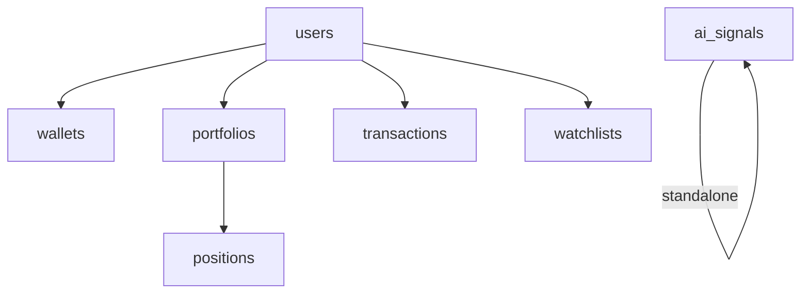

# ApexTrade AI - Database Design Guide

## Purpose

PostgreSQL is the system of record for virtual financial state: wallet cash, portfolios, positions, and immutable transaction history.

ApexTrade AI is a paper-trading system. PostgreSQL state represents simulated money and holdings only. It does not represent real brokerage accounts or executed live-market orders.

## Why PostgreSQL and Flyway

PostgreSQL supports ACID transactions, constraints, and exact decimal storage.

Flyway manages versioned SQL migrations under `backend-java/src/main/resources/db/migration/`. Never edit an applied migration. Make a new Flyway version for schema changes.

The P0-2 migrations must not be described as verified against PostgreSQL until a live database run has occurred.

## Table Relationships



- `users` → `wallets`: one-to-one
- `users` → `portfolios`: one-to-one
- `portfolios` → `positions`: one-to-many
- `users` → `transactions`: one-to-many
- `users` → `watchlists`: one-to-many
- `ai_signals`: standalone AI recommendation history

## Financial Tables

### wallets

- One wallet per user.
- `cash_balance` uses `DECIMAL(15,2)`.
- The normal virtual starting cash is $10,000.
- P0-2 adds a non-negative CHECK constraint.

### portfolios

- One portfolio per user.
- `total_value` uses `DECIMAL(15,2)`.
- `total_return_percent` uses `DECIMAL(10,2)`.

### positions

- One position per portfolio and normalized symbol.
- `quantity` uses `DECIMAL(15,4)`.
- `average_cost` uses `DECIMAL(15,2)`.
- P0-2 adds a positive-quantity CHECK constraint.
- A full sell deletes the position rather than storing quantity zero.

### transactions

- Stores BUY and SELL history.
- `quantity` uses `DECIMAL(15,4)`.
- `price` and `total_amount` use `DECIMAL(15,2)`.
- Transaction rows should be treated as the trade audit history.

## P0-2 Migration V8

Implemented migration:

`backend-java/src/main/resources/db/migration/V8__add_trade_constraints.sql`

```sql
ALTER TABLE wallets
    ADD CONSTRAINT chk_wallets_cash_balance_non_negative
    CHECK (cash_balance >= 0) NOT VALID;

ALTER TABLE positions
    ADD CONSTRAINT chk_positions_quantity_positive
    CHECK (quantity > 0) NOT VALID;
```

`NOT VALID` permits existing database rows to remain without blocking migration application. Future inserts and updates are still constrained. It does not validate or clean existing rows.

### V8 Status

- **Implemented:** yes.
- **Executed against PostgreSQL:** no.
- **Database constraint test passed:** no live test executed.
- **Legacy-row cleanup:** deferred.

Do not claim V8 passed in a live database until Flyway and PostgreSQL validation are run.

## Precision and Comparisons

Use `BigDecimal` for money and quantities. Java code must not use `double` or `float` for financial arithmetic.

Use `compareTo(...)` instead of `equals(...)` when comparing scale-sensitive `BigDecimal` values.

Recommended P0-2 limits:

- Quantity: greater than zero, scale at most 4, maximum `1,000,000.0000`.
- Market price: greater than zero, maximum `1,000,000.00`, normalized to scale 2.
- Symbol: trimmed, uppercase, and matched against `^[A-Z]{1,10}$`.

## Transaction Safety

Trade methods use `@Transactional`, allowing wallet, position, and transaction changes to roll back together when an exception occurs.

However, `@Transactional` alone does not provide:

- Pessimistic or optimistic row locking.
- Protection against concurrent lost updates.
- Idempotency or duplicate-trade prevention.

These remain P0-3 work.

## FOREIGN KEYS and ON DELETE

Foreign keys prevent orphaned rows. Existing cascade rules apply, for example:

- Deleting a user cascades to its wallet and portfolio in the current schema.
- Deleting a portfolio cascades to its positions.

See migrations V1–V7 for the exact applied foreign-key definitions and cascade rules.

## UUIDs

ApexTrade uses UUID primary keys for unpredictability and safe application-level identity. UUID does not replace authentication or authorization checks.

## Deferred Database Checks

Until PostgreSQL/Docker is available:

- Flyway V8 execution.
- Constraint enforcement tests.
- Rollback tests after insufficient-funds or insufficient-shares failures.
- Concurrent buy/sell tests.
- Legacy dirty-row repair and constraint validation.
