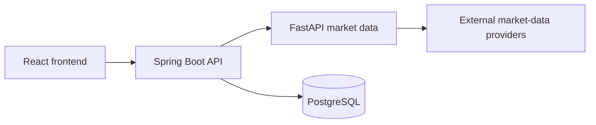

# ApexTrade AI - Project Overview

## Purpose

ApexTrade AI is a paper-trading platform that combines a React frontend, a Spring Boot application, a FastAPI market-data service, and PostgreSQL.

It uses real, delayed, or historical external market data and simulated cash and holdings. It does not place real brokerage orders.

## Services

- **Frontend:** React 19 + Vite.
- **Java backend:** Spring Boot gateway, authentication, virtual-trading, and PostgreSQL persistence.
- **Python backend:** FastAPI market-data and AI-related services.
- **Database:** PostgreSQL for virtual wallets, portfolios, positions, and transaction history.

## Request Flow

The frontend calls Java only for application APIs. Java calls Python for market data and stores paper-trading state in PostgreSQL.

## P0-2 Trade Safety

P0-2 implemented:

- Typed and validated trade requests.
- Symbol normalization and quantity/price limits.
- Insufficient-funds and insufficient-shares checks.
- Consistent JSON trade errors.
- V8 database CHECK constraints.
- PAPER-mode startup enforcement.
- 14 passing unit tests.

V8 was implemented but not executed against PostgreSQL in P0-2. Docker and database runtime checks remain deferred.

## P0-3 Outstanding Work

P0-3 is not yet implemented:

- Wallet/position locking or optimistic versioning.
- Concurrent trade safety tests.
- Idempotency and duplicate-trade prevention.
- Java outbound HTTP timeout configuration.

`@Transactional` should not be described as a concurrency or idempotency solution.

## Repository Structure

- `backend-java/`: Spring Boot API, persistence, migrations, and trade engine.
- `backend-python/`: market-data and AI service.
- `frontend/`: React UI.
- `docs/`: architecture, API, database, deployment, and phase reports.

## Documentation

See `docs/README.md` for the documentation index. The authoritative P0-2 report is `docs/phases/P0-2_TRADE_SAFETY.md`.
