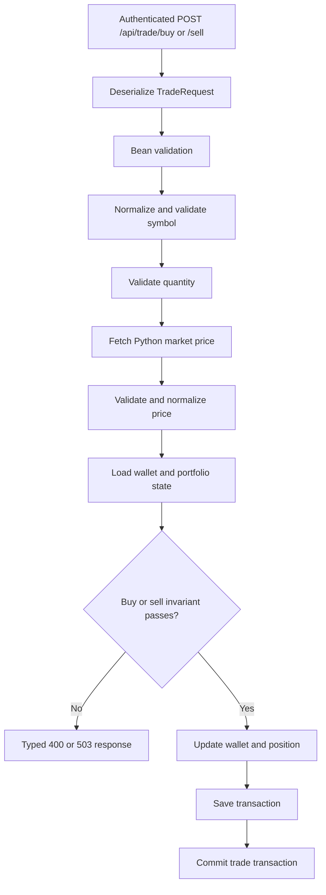

# P0-2: Trade Safety and PAPER-Mode Enforcement

**Status:** Implementation complete; unit-tested; database/runtime integration deferred.

P0-2 hardens the existing paper-trading flow. It does not implement live brokerage execution, P0-3 concurrency controls, or unrelated backend/frontend features.

## 1. Problems and Root Causes

The original trade implementation had no service-level validation boundary:

- `TradeController` parsed quantities with `new BigDecimal(request.get("quantity"))` and accepted a `Map<String, String>` request.
- `TradeService` fetched a price before validating the symbol or quantity.
- Upstream price parsing did not reject missing, zero, negative, malformed, or oversized values.
- Buy/sell logic could mutate wallet or position state for invalid input or insufficient holdings.
- Negative quantities could change balances in the wrong direction.
- A full sell retained a position with `quantity = 0`, conflicting with future positive-position invariants.
- The database had precision columns but no CHECK constraints for non-negative cash or positive positions.
- There was no typed, consistent JSON error contract for trade failures.
- There was no startup guard enforcing the simulated-only trading mode.

The original service mutating methods were `@Transactional`, but P0-2 does not claim that transactions alone prevent concurrent lost updates or duplicate requests. Those are P0-3 concerns.

## 2. Implementation Summary

P0-2 adds:

- A typed `TradeRequest` DTO with Jakarta Bean Validation.
- Shared trade validation helpers for symbols, quantities, and upstream prices.
- Typed `ApiException` failures and a `@RestControllerAdvice` JSON error envelope.
- Constructor-injected `RestTemplate`, using the bean already declared in `AppConfig`.
- Validation before upstream price fetch and before repository mutation.
- Full-sell position deletion instead of saving a zero quantity.
- Flyway migration V8 with `NOT VALID` financial CHECK constraints.
- A startup component that refuses to run unless `trading.mode=PAPER`.
- Focused unit tests for validation, service state safety, and startup mode.

## 3. Trade Flow



The authenticated user ID continues to come from `SecurityContextHolder`. It is not read from the request body.

## 4. Validation and Precision Rules

### Symbol

`TradeRules.normalizeSymbol`:

1. Rejects null symbols.
2. Trims whitespace.
3. Converts letters to uppercase using `Locale.ROOT`.
4. Requires `^[A-Z]{1,10}$`.

The normalized symbol is used for the upstream URL, position lookup, and persisted transaction/position values.

### Quantity

`TradeRequest` requires:

- A non-null quantity.
- A positive quantity.
- Integer capacity of at most 7 digits.
- Scale of at most 4 decimal places.
- A maximum of `1,000,000.0000`.

`TradeRules.validateQuantity` applies the positive, scale, and maximum checks again inside the service. This second check prevents direct service calls from bypassing DTO validation.

### Market Price

`TradeRules.validatePrice` rejects:

- Null or missing price values.
- Empty values.
- Unparseable values.
- Zero and negative prices.
- Prices above `1,000,000.00`.

Valid prices are normalized to scale 2 with `RoundingMode.HALF_UP`.

A price parse failure or invalid price is an upstream 503 `UPSTREAM_INVALID_PRICE` error. A `RestClientException` is mapped to 503 `UPSTREAM_UNAVAILABLE`.

### Financial Types

Money and quantities use `BigDecimal`:

- Wallet cash: `DECIMAL(15,2)`.
- Position quantity: `DECIMAL(15,4)`.
- Position average cost and transaction price/amount: `DECIMAL(15,2)`.

The code compares quantities and balances with `compareTo`, not `equals`. The trade cost and proceeds are rounded to scale 2 with `HALF_UP`.

## 5. Rejection and State Safety

Validation and upstream validation happen before wallet or position mutations.

Buy failures include:

- 400 `INSUFFICIENT_FUNDS` when cash is missing or lower than the cost.
- 400 `POSITION_NOT_FOUND` if the wallet or portfolio is missing.

Sell failures include:

- 400 `POSITION_NOT_FOUND` if the portfolio or position is missing.
- 400 `INSUFFICIENT_SHARES` if the position quantity is null or lower than the requested quantity.

Insufficient-funds, insufficient-shares, and invalid-input unit tests assert that repositories are not used to save or delete state.

A full sell subtracts the quantity and deletes the position row when the new quantity is exactly zero. It does not save `quantity = 0`.

## 6. Error Contract

`GlobalExceptionHandler` provides the following P0-2 mappings:

| Situation | HTTP status | Code |
|-----------|-------------|------|
| Bean validation failure | 400 | `VALIDATION_ERROR` |
| Malformed/non-readable JSON | 400 | `MALFORMED_REQUEST` |
| Invalid or missing symbol | 400 | `INVALID_SYMBOL` |
| Invalid quantity | 400 | `INVALID_QUANTITY` |
| Insufficient virtual funds | 400 | `INSUFFICIENT_FUNDS` |
| Insufficient virtual shares | 400 | `INSUFFICIENT_SHARES` |
| Missing wallet, portfolio, or position | 400 | `POSITION_NOT_FOUND` |
| Invalid/missing upstream price | 503 | `UPSTREAM_INVALID_PRICE` |
| Upstream service unavailable | 503 | `UPSTREAM_UNAVAILABLE` |
| Database constraint violation | 409 | `DATA_INTEGRITY_VIOLATION` |
| Unexpected exception | 500 | `INTERNAL_ERROR` |

The `ErrorResponse` record contains `timestamp`, `status`, `code`, `message`, `path`, and `fieldErrors`.

## 7. V8 Migration

The implemented migration is:

`backend-java/src/main/resources/db/migration/V8__add_trade_constraints.sql`

```sql
ALTER TABLE wallets
    ADD CONSTRAINT chk_wallets_cash_balance_non_negative
    CHECK (cash_balance >= 0) NOT VALID;

ALTER TABLE positions
    ADD CONSTRAINT chk_positions_quantity_positive
    CHECK (quantity > 0) NOT VALID;
```

### Why `NOT VALID`?

`NOT VALID` allows the migration to be added even if existing rows already violate the new rules. PostgreSQL still enforces the constraints for future inserts and updates, while existing rows remain pending for separate validation/cleanup.

No migration execution, constraint validation, legacy-row cleanup, or live database test was performed in P0-2. The migration is implemented but not executed against PostgreSQL in this environment.

## 8. PAPER-Mode Startup Guard

`TradingModeGuard` reads:

```properties
trading.mode=${TRADING_MODE:PAPER}
```

During Spring component initialization, it rejects any mode except case-insensitive `PAPER` and throws `IllegalStateException`. This means the application context is expected to fail startup if `TRADING_MODE` is `LIVE`, `SANDBOX`, or another unsupported value.

No live Spring startup test was executed in P0-2, so startup failure behavior is documented from the source implementation and unit-tested with direct guard calls.

## 9. Files Created or Modified

### Production files

- `backend-java/src/main/java/com/apextrade/dto/TradeRequest.java`
- `backend-java/src/main/java/com/apextrade/validation/TradeRules.java`
- `backend-java/src/main/java/com/apextrade/exception/ApiException.java`
- `backend-java/src/main/java/com/apextrade/exception/ErrorResponse.java`
- `backend-java/src/main/java/com/apextrade/exception/GlobalExceptionHandler.java`
- `backend-java/src/main/java/com/apextrade/config/TradingModeGuard.java`
- `backend-java/src/main/java/com/apextrade/controller/TradeController.java`
- `backend-java/src/main/java/com/apextrade/service/TradeService.java`
- `backend-java/src/main/resources/db/migration/V8__add_trade_constraints.sql`
- `backend-java/src/main/resources/application.properties`
- `backend-java/pom.xml`

### Test files

- `backend-java/src/test/java/com/apextrade/validation/TradeRulesTest.java`
- `backend-java/src/test/java/com/apextrade/dto/TradeRequestValidationTest.java`
- `backend-java/src/test/java/com/apextrade/service/TradeServiceTest.java`
- `backend-java/src/test/java/com/apextrade/config/TradingModeGuardTest.java`
- `backend-java/src/test/resources/junit-platform.properties`

The JUnit property/Byte Buddy compatibility setting is test infrastructure for the local Java 24 runtime. Application runtime behavior was not changed.

## 10. Test Results

The P0-2 test suite is unit-only:

| Test class | Tests | Failures | Errors | Skipped |
|------------|------:|---------:|-------:|--------:|
| `TradingModeGuardTest` | 2 | 0 | 0 | 0 |
| `TradeRequestValidationTest` | 3 | 0 | 0 | 0 |
| `TradeServiceTest` | 4 | 0 | 0 | 0 |
| `TradeRulesTest` | 5 | 0 | 0 | 0 |
| **Total** | **14** | **0** | **0** | **0** |

Coverage includes invalid symbol/quantity/price data, DTO constraints, no-mutation assertions, full-sell deletion, insufficient funds/shares, and PAPER/non-PAPER startup guard behavior.

## 11. Maven Result

`mvn package` completed with `BUILD SUCCESS` and produced:

`backend-java/target/apextrade-java-0.0.1-SNAPSHOT.jar`

This package result confirms compilation and unit-test execution. It does not start Docker, PostgreSQL, Flyway, or the Spring application.

## 12. Deferred and Outstanding Work

Docker Desktop and a PostgreSQL runtime were unavailable, so P0-2 did not execute:

- Flyway V8 migration.
- Database CHECK-constraint integration tests.
- Existing-row validation or repair of legacy data.
- Spring application startup with PAPER and non-PAPER modes.
- Live buy/sell HTTP tests.
- Docker Compose smoke tests.

P0-3 remains outstanding:

- Row locking or optimistic versioning for read-modify-write financial state.
- Idempotency keys and duplicate-trade prevention.
- Java outbound HTTP timeout configuration for market-price calls.
- Concurrency tests for simultaneous buys/sells.
- Integration tests for rollback and database constraint enforcement.

`@Transactional` is still useful for method rollback behavior, but it alone does not guarantee concurrency safety or prevent duplicate requests.
